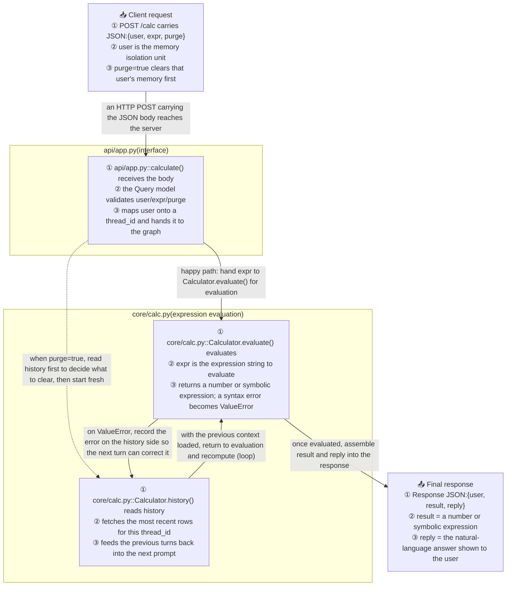

# ProjectFlow

**A skill that turns any codebase into a readable execution-flow diagram.**

Point your agent at a repository. ProjectFlow reads the code and writes `docs/project_flow.md` — one Mermaid `flowchart TD` that traces the project from its input to its output, with every method annotated and every edge explained.

**English** | [简体中文](README.zh-CN.md)

[](LICENSE)


---

## What you get



Under the diagram it writes a **Key Notes** table (one row per method) and a few **mechanism notes** covering what a diagram cannot show — how the loop terminates, how memory resumes, what happens when a dependency is down.

## Why it reads better than an auto-generated call graph

| | Typical call graph | ProjectFlow |
|---|---|---|
| Node content | `calculate` | `① api/app.py::calculate() receives the body` + inputs, returns, failure mode |
| Edge labels | none | what is passed, why, and under which condition |
| Loops | flattened or missing | back-edge drawn and labelled `(loop)` |
| Fallbacks | omitted | drawn, e.g. "Milvus unavailable → in-memory fallback" |
| Order | directory order | the order a request actually travels |
| Language | whatever the tool emits | follows your repo's documentation language |

## Install

No dependencies, no build step, no scripts — the skill is a single `SKILL.md`. Clone the repo, then drop the skill folder into whatever directory your agent scans for skills.

```bash
git clone https://github.com/CaoN1Ma/PROJECT_FLOW.git
cp -r PROJECT_FLOW/skills/project-flow <your-skills-dir>/
```

The folder has to end up as `<your-skills-dir>/project-flow/SKILL.md`. Known locations:

| Agent / harness | User-level skills directory |
|---|---|
| Claude Code | `~/.claude/skills/` |
| opencode | `~/.config/opencode/skills/` |
| harnesses using the shared skill convention | `~/.agents/skills/` |
| anything else | whatever directory your agent scans for `<name>/SKILL.md` |

Most harnesses also accept a **project-scoped** copy inside the repo you are documenting — `.claude/skills/`, `.agents/skills/` or `.dsh/skills/` — useful for pinning the skill to one project or sharing it through that project's git history.

On Windows the same paths are `%USERPROFILE%\.claude\skills\`, and the copy step is:

```powershell
git clone https://github.com/CaoN1Ma/PROJECT_FLOW.git
Copy-Item -Recurse PROJECT_FLOW\skills\project-flow "$env:USERPROFILE\.claude\skills\"
```

**Symlink instead of copying** if you want `git pull` to update the installed skill in place:

```bash
ln -s "$PWD/PROJECT_FLOW/skills/project-flow" ~/.claude/skills/project-flow
```

**Manual install:** download [`skills/project-flow/SKILL.md`](skills/project-flow/SKILL.md) into `<your-skills-dir>/project-flow/SKILL.md`. That file is the entire skill — no runtime, no packages, nothing to configure.

**Uninstall:** delete the `project-flow` folder from your skills directory.

## Usage

Just ask:

```
Draw the project flow for this repo.
```

```
画项目流程图 / 生成 PROJECT_FLOW
```

Other phrasings that trigger it: *execution path*, *how does this project run*, *project structure diagram*, *map the call flow*, *执行链路*, *看懂项目怎么跑起来*.

Output goes to `docs/project_flow.md` (created if missing, overwritten on re-run). Commit it — it diffs well, and it re-generates in seconds when the architecture changes.

## Repository layout

```
.
├── README.md               # English (this file)
├── README.zh-CN.md         # 简体中文
├── LICENSE                 # MIT
└── skills/
    └── project-flow/
        └── SKILL.md        # the entire skill: format contract, steps, worked example, syntax rules
```

Every skill in this repo lives at `skills/<name>/SKILL.md`. Copy that folder — not the repo root — into your agent's skills directory.

The repository is called `PROJECT_FLOW`; the skill it ships is named `project-flow`, because agent harnesses require skill names to be lowercase kebab-case.

## License

MIT — see [LICENSE](LICENSE). Use it, fork it, ship it.

---

[简体中文说明 →](README.zh-CN.md)
