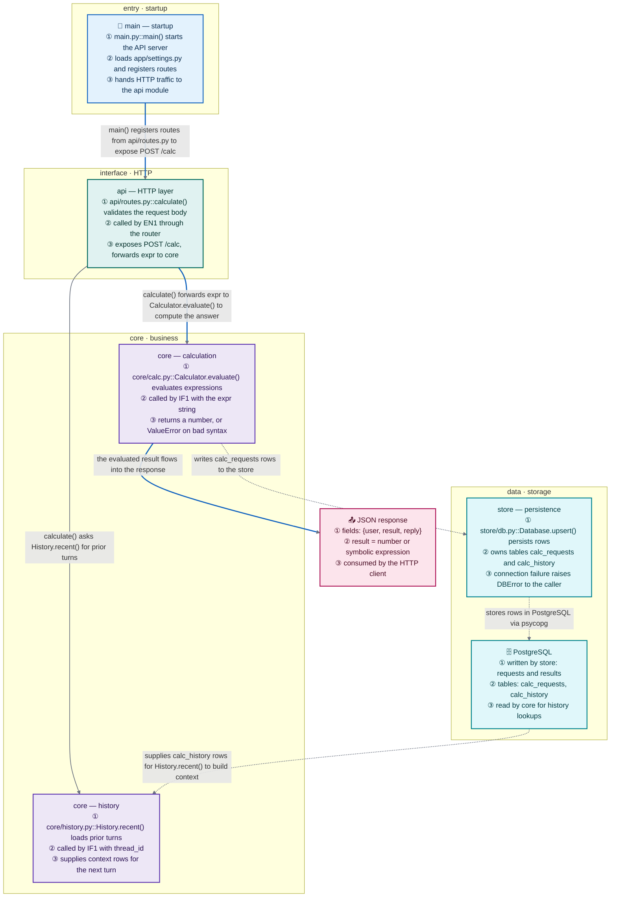

# ProjectFlow

**A skill that turns any codebase into a readable module map for newcomers — plus an on-demand execution-flow trace.**

Point your agent at a repository. ProjectFlow reads the code (AST-first) and writes `docs/project_overview.md`: one Mermaid map where every module is a role-colored node, every edge says what is passed and why — solid arrows are code references, dashed arrows are data movement — followed by a newcomer reading guide, a catalog row for every source file, and data-flow notes. Ask it to trace a specific request, endpoint, or CLI command and it writes `docs/project_flow.md` instead: 📥 input → one subgraph per file → 📤 output.

**English** | [简体中文](README.zh-CN.md)

[](LICENSE)


---

## What you get



**Solid arrow = code reference** — who imports/calls whom, and which symbols flow between them. **Dashed arrow = data movement** — it points the way the data moves: writes flow into the store, reads flow back out. The blue path is the spine a newcomer should trace first.

Under the diagram, `docs/project_overview.md` carries the parts a map cannot:

- **How to read this codebase** — a numbered reading guide, every step anchored to a real `file::symbol()`
- **File Catalog** — one row per source file: role, key symbols, one-line purpose (every file, even ones merged out of the map)
- **Data Flow** — where data is born, how each module transforms it in order, where it is stored, what leaves
- **Mechanism notes** — the things a static map cannot show: how a loop terminates, what degrades when a dependency is down

Modules are capped at 12 — past that a map stops being glanceable, so sibling directories merge upward and every merged file stays in the catalog. Node color encodes the role — startup, interface, core logic, data, external, artifact — and each color carries its own text color, so labels stay readable at ≥ 11:1 contrast in any theme.

**On demand — the request-flow trace:** ask for the path of a concrete request (an endpoint, `main()`, a CLI command) and ProjectFlow writes `docs/project_flow.md` instead: one `flowchart TD` going 📥 input → one subgraph per file → 📤 output, every method annotated (inputs, returns, failure mode), every edge explaining what is passed and why, with loops and fallbacks drawn as back-edges instead of flattened away.

## Two modes

| Mode | Trigger | Output |
|---|---|---|
| Module overview (default) | project structure, module map, what each file does, who calls whom, where data flows, onboarding — 模块图 / 项目结构图 / 项目地图 / 模块依赖 / 数据流向 / 新人导读 / project structure / module diagram / map the project | `docs/project_overview.md` |
| Request flow (on demand) | the path of ONE concrete request: an endpoint, `main()`, a CLI command, a message — 执行链路 / 请求流程 / 调用链 / trace the flow / how does this project run | `docs/project_flow.md` |

A bare "draw the project flow / 画项目流程图" produces the module overview — the map is the front door. Name a specific entry to get the request trace.

## Why it reads better than an auto-generated call graph

| | Typical call graph | ProjectFlow |
|---|---|---|
| Granularity | one node per function (hundreds) | one node per module (≤ 12), every file in the catalog |
| Node content | `calculate` | module job + key `file::symbol()` + who calls it + what it exposes |
| Edge labels | none | what symbol is passed, why, and under which condition |
| Data | not shown | dashed edges point the way data moves; data-flow notes explain the stores |
| Where to start | not shown | reading guide anchored to real `file::symbol()` steps |
| Loops | flattened or missing | drawn as back-edges, labelled `(loop)` / `(mutual reference)` |
| Fallbacks | omitted | drawn, e.g. "fallback: Milvus down → in-memory cache" |
| Order | whatever the tool emits | modules ordered by distance from the entry, layers top to bottom |
| Language | whatever the tool emits | follows your repo's documentation language |
| Color | none, or one color for everything | node color encodes **role**; every text-on-background pair is contrast-checked (≥ 11:1) |

## Install

No dependencies, no build step, no scripts — the skill is a single `SKILL.md`. Clone the repo, then drop the skill folder into whatever directory your agent scans for skills.

```bash
git clone https://github.com/CaoN1Ma/PROJECT_FLOW.git
cp -r PROJECT_FLOW/skills/project-flow <your-skills-dir>/
```

The folder has to end up as `<your-skills-dir>/project-flow/SKILL.md`. Known locations:

| Agent / harness | User-level skills directory |
|---|---|
| Claude Code | `~/.claude/skills/` |
| opencode | `~/.config/opencode/skills/` |
| harnesses using the shared skill convention | `~/.agents/skills/` |
| anything else | whatever directory your agent scans for `<name>/SKILL.md` |

Most harnesses also accept a **project-scoped** copy inside the repo you are documenting — `.claude/skills/`, `.agents/skills/` or `.dsh/skills/` — useful for pinning the skill to one project or sharing it through that project's git history.

On Windows the same paths are `%USERPROFILE%\.claude\skills\`, and the copy step is:

```powershell
git clone https://github.com/CaoN1Ma/PROJECT_FLOW.git
Copy-Item -Recurse PROJECT_FLOW\skills\project-flow "$env:USERPROFILE\.claude\skills\"
```

**Symlink instead of copying** if you want `git pull` to update the installed skill in place:

```bash
ln -s "$PWD/PROJECT_FLOW/skills/project-flow" ~/.claude/skills/project-flow
```

**Manual install:** download [`skills/project-flow/SKILL.md`](skills/project-flow/SKILL.md) into `<your-skills-dir>/project-flow/SKILL.md`. That file is the entire skill — no runtime, no packages, nothing to configure.

**Uninstall:** delete the `project-flow` folder from your skills directory.

## Usage

Just ask:

```
Map this project's modules for a newcomer.
```

```
画项目结构图 / 生成 PROJECT_FLOW
```

Other phrasings that trigger the overview: *project structure*, *module diagram*, *module dependencies*, *data flow*, *what does each file do*, *onboarding*, *看懂项目*, *项目地图*, *模块依赖*, *数据流向*, *新人导读*. For the request trace, name the entry: *trace the flow of POST /calc*, *执行链路*, *how does this CLI command run*.

The overview goes to `docs/project_overview.md`, the request trace to `docs/project_flow.md` (both created if missing, overwritten on re-run). Commit them — they diff well, and re-generate in seconds when the architecture changes.

## Repository layout

```
.
├── README.md               # English (this file)
├── README.zh-CN.md         # 简体中文
├── LICENSE                 # MIT
├── architecture/           # this repo's own pipeline, rendered with the archify skill
│   ├── projectflow-dataflow.json   # archify spec (source of truth)
│   └── projectflow-dataflow.html   # explorable diagram: repo → skill → documents → reader
└── skills/
    └── project-flow/
        └── SKILL.md        # the entire skill: mode router, format contract, steps, worked example, syntax rules
```

Every skill in this repo lives at `skills/<name>/SKILL.md`. Copy that folder — not the repo root — into your agent's skills directory.

The repository is called `PROJECT_FLOW`; the skill it ships is named `project-flow`, because agent harnesses require skill names to be lowercase kebab-case.

## License

MIT — see [LICENSE](LICENSE). Use it, fork it, ship it.

---

[简体中文说明 →](README.zh-CN.md)
