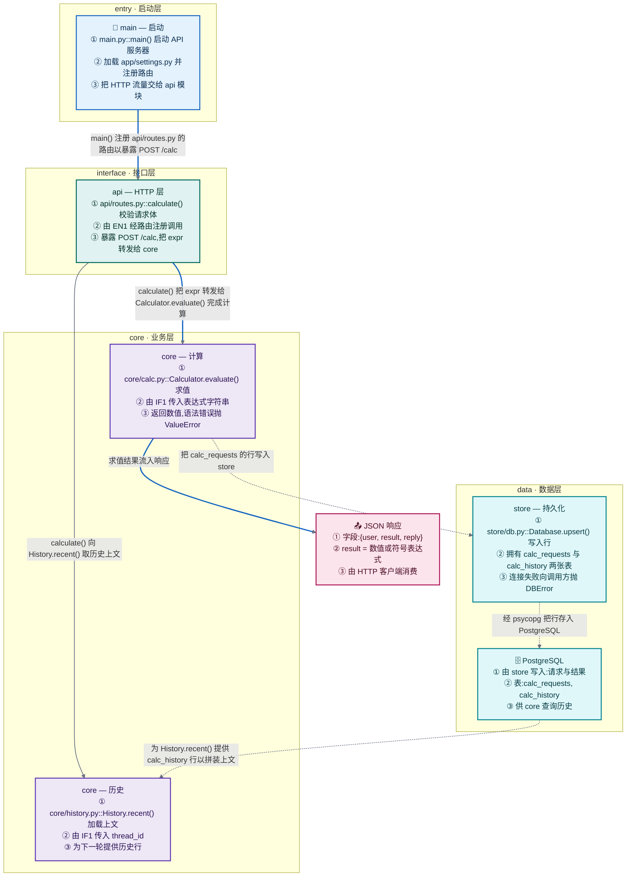

# ProjectFlow

**把任意代码库变成一张新人看得懂的模块图 —— 另可用时生成执行链路追踪。一个 agent skill。**

把它指向一个仓库，它会先读代码（AST 解析），然后写出 `docs/project_overview.md`：一张 Mermaid 图，每个模块是一个按职责着色的节点，每条连线都写明传了什么、为什么传 —— 实线是代码引用，虚线是数据流向 —— 下面还附新人导读、每个源文件的一行档案和数据流向说明。让它追踪某个具体请求、接口或 CLI 命令时，则改写 `docs/project_flow.md`：📥 输入 → 每个文件一个子图 → 📤 输出。

**简体中文** | [English](README.md)

[](LICENSE)


---

## 你会得到什么



**实线 = 代码引用** —— 谁 import/调用谁,符号怎么流动。**虚线 = 数据流向** —— 箭头指向数据移动的方向:写入流向存储,读取从存储流出。蓝色路径是新人该先跟的主干。

图之下,`docs/project_overview.md` 装着地图装不下的部分:

- **新人导读** —— 编号阅读步骤,每一步都锚定到真实的 `file::symbol()`
- **文件目录** —— 每个源文件一行:职责、关键符号、一句话用途(即使被并进其他模块的文件也不漏)
- **数据流向** —— 数据从哪来、依次经过哪些模块转换、存在哪、最终输出什么
- **机制说明** —— 静态图表达不了的东西:循环靠什么终止、依赖挂了怎么降级

模块数上限 12 —— 超过就不再一眼可读,所以同级目录会向上合并,而被并入的每个文件仍留在目录表里。节点颜色编码职责 —— 启动 / 接口 / 核心 / 数据 / 外部 / 产物 —— 每种配色自带文字色,任何主题下对比度都 ≥ 11:1。

**按需 —— 请求链路追踪**:让 skill 追踪某个具体请求(一个端点、`main()`、一条 CLI 命令)时,它改写 `docs/project_flow.md`:一张 `flowchart TD`,📥 输入 → 每个文件一个子图 → 📤 输出,每个方法都注有入参、返回、失败方式,每条连线都写明传了什么、为什么传,循环与降级作为回边画出而不是被拍扁。

## 两种模式

| 模式 | 触发说法 | 产出 |
|---|---|---|
| 模块全景图(默认) | 项目结构、模块图、每个文件是干嘛的、谁调用谁、数据流向、新人上手 —— 模块图 / 项目结构图 / 项目地图 / 模块依赖 / 数据流向 / 新人导读 / project structure / module diagram / map the project | `docs/project_overview.md` |
| 请求链路(按需) | 某**一个**具体请求的路径:端点、`main()`、CLI 命令、消息 —— 执行链路 / 请求流程 / 调用链 / trace the flow / how does this project run | `docs/project_flow.md` |

只说「画项目流程图 / draw the project flow」默认产出模块全景图 —— 地图是前门;指明具体入口才生成链路追踪。

## 为什么它比自动生成的调用图好读

| | 常见的调用图 | ProjectFlow |
|---|---|---|
| 粒度 | 每个函数一个节点(成百上千) | 每个模块一个节点(≤ 12),每个文件进目录表 |
| 节点内容 | `calculate` | 模块职责 + 关键 `file::symbol()` + 谁调用它 + 它暴露什么 |
| 连线 | 没有说明 | 传哪个符号、为什么传、什么条件下传 |
| 数据 | 不体现 | 虚线箭头指向数据移动方向;数据流向说明讲清存储 |
| 从哪读起 | 不体现 | 每步锚定真实 `file::symbol()` 的导读 |
| 循环 | 被拍平或缺失 | 画成回边,标 `(loop)` / `(mutual reference)` |
| 降级 | 省略 | 画出来,例如「fallback:Milvus 挂了 → 内存兜底」 |
| 顺序 | 工具输出什么就是什么 | 按距入口的远近排序,层自上而下 |
| 语种 | 工具输出什么就是什么 | 跟随你仓库的文档语言 |
| 配色 | 没有,或全图一色 | 节点颜色编码**职责**,每对文字与底色都验过对比度(≥ 11:1) |

## 安装

没有任何依赖、没有构建步骤、没有脚本 —— skill 本体就是一个 `SKILL.md`。克隆仓库,再把 skill 文件夹放进你的 agent 会扫描的 skill 目录即可。

```bash
git clone https://github.com/CaoN1Ma/PROJECT_FLOW.git
cp -r PROJECT_FLOW/skills/project-flow <你的 skill 目录>/
```

最终路径必须是 `<你的 skill 目录>/project-flow/SKILL.md`。常见位置:

| Agent / 工具 | 用户级 skill 目录 |
|---|---|
| Claude Code | `~/.claude/skills/` |
| opencode | `~/.config/opencode/skills/` |
| 遵循通用 skill 约定的工具 | `~/.agents/skills/` |
| 其它 | 你的 agent 扫描 `<名字>/SKILL.md` 的那个目录 |

大多数工具也支持把 skill **放进具体项目**里 —— `.claude/skills/`、`.agents/skills/` 或 `.dsh/skills/`,适合把 skill 固定到某个项目、或者跟着该项目的 git 一起共享。

Windows 下对应 `%USERPROFILE%\.claude\skills\` 等路径,复制这一步是:

```powershell
git clone https://github.com/CaoN1Ma/PROJECT_FLOW.git
Copy-Item -Recurse PROJECT_FLOW\skills\project-flow "$env:USERPROFILE\.claude\skills\"
```

**想让它跟着 `git pull` 自动更新,用软链接代替复制:**

```bash
ln -s "$PWD/PROJECT_FLOW/skills/project-flow" ~/.claude/skills/project-flow
```

**手动安装:** 下载 [`skills/project-flow/SKILL.md`](skills/project-flow/SKILL.md),保存到 `<你的 skill 目录>/project-flow/SKILL.md` 即可 —— 整个 skill 就这一个文件,没有运行时、没有依赖、没有要配置的东西。

**卸载:** 把 skill 目录里的 `project-flow` 文件夹删掉就行。

## 使用

直接说一句就行:

```
给新人画一张这个项目的模块图。
```

```
画项目结构图 / 生成 PROJECT_FLOW
```

其它触发全景图的说法:*项目结构*、*模块图*、*模块依赖*、*数据流向*、*每个文件是干嘛的*、*新人上手*、*看懂项目*、*项目地图*、*模块依赖*、*数据流向*、*新人导读*。要追踪某个请求,则指明入口:*追踪 POST /calc 的执行链路*、*执行链路*、*这条 CLI 命令怎么跑起来*。

全景图写到 `docs/project_overview.md`,请求链路写到 `docs/project_flow.md`(没有 `docs/` 会自动建,重复运行整体覆盖)。建议提交进仓库 —— 它们 diff 友好,架构一变几秒就能重生成。

## 仓库结构

```
.
├── README.md               # 英文
├── README.zh-CN.md         # 简体中文(本文件)
├── LICENSE                 # MIT
├── architecture/           # 本仓库自身流水线,用 archify skill 渲染
│   ├── projectflow-dataflow.json   # archify 规范(事实来源)
│   └── projectflow-dataflow.html   # 可交互图:仓库 → skill → 文档 → 读者
└── skills/
    └── project-flow/
        └── SKILL.md        # skill 本体:模式路由、格式契约、步骤、完整例子、语法红线
```

本仓库里每个 skill 都放在 `skills/<名字>/SKILL.md`。安装时拷的是**这个文件夹**,不是仓库根目录。

仓库名叫 `PROJECT_FLOW`,里面的 skill 名叫 `project-flow` —— agent 工具要求 skill 名必须是小写 kebab-case,所以两者大小写不同。

## 许可证

MIT —— 见 [LICENSE](LICENSE)。随便用、随便改、随便发。
