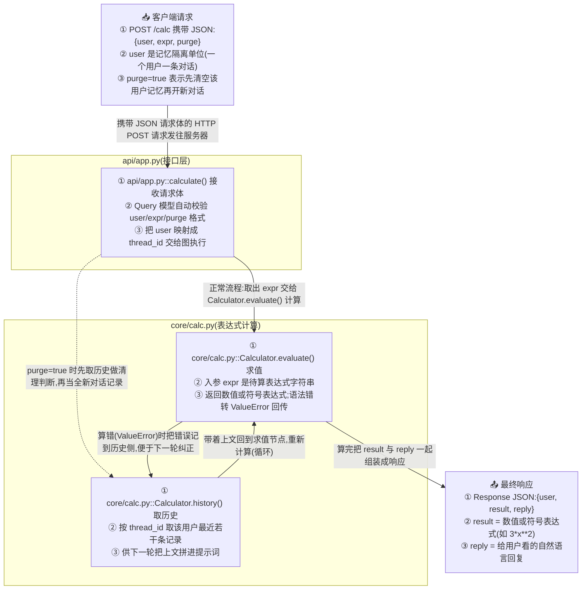

# ProjectFlow

**把任意代码库变成一张看得懂的执行流程图 —— 一个 agent skill。**

把它指向一个仓库，它会读代码并写出 `docs/project_flow.md`：一张 Mermaid `flowchart TD`，从输入一路画到输出，每个方法都有注记，每条连线都有说明。

**简体中文** | [English](README.md)

[](LICENSE)


---

## 你会得到什么



图下面还会写一张 **「关键说明」表格**（图里每个方法一行）和 **2~4 条机制说明**，专门讲图上看不出来的东西 —— 循环靠什么停、记忆怎么续上、依赖挂了怎么办。

## 为什么它比自动生成的调用图好读

| | 常见的调用图 | ProjectFlow |
|---|---|---|
| 节点内容 | `calculate` | `① api/app.py::calculate() 接收请求体` + 入参、返回、失败方式 |
| 连线 | 没有说明 | 写明传了什么、为什么传、什么条件下传 |
| 循环 | 被拍平或干脆没有 | 回边必须画出来并标 `(循环)` |
| 降级路径 | 省略 | 画出来，例如「Milvus 不可用→内存兜底」 |
| 顺序 | 按目录 | 按请求**实际流经**的顺序 |
| 语种 | 工具输出什么就是什么 | 跟随你仓库的文档语言 |

## 安装

没有任何依赖、没有构建步骤、没有脚本 —— skill 本体就是一个 `SKILL.md`。克隆仓库，再把 skill 文件夹放进你的 agent 会扫描的 skill 目录即可。

```bash
git clone https://github.com/CaoN1Ma/PROJECT_FLOW.git
cp -r PROJECT_FLOW/skills/project-flow <你的 skill 目录>/
```

最终路径必须是 `<你的 skill 目录>/project-flow/SKILL.md`。常见位置：

| Agent / 工具 | 用户级 skill 目录 |
|---|---|
| Claude Code | `~/.claude/skills/` |
| opencode | `~/.config/opencode/skills/` |
| 遵循通用 skill 约定的工具 | `~/.agents/skills/` |
| 其它 | 你的 agent 扫描 `<名字>/SKILL.md` 的那个目录 |

大多数工具也支持把 skill **放进具体项目**里 —— `.claude/skills/`、`.agents/skills/` 或 `.dsh/skills/`，适合把 skill 固定到某个项目、或者跟着该项目的 git 一起共享。

Windows 下对应 `%USERPROFILE%\.claude\skills\` 等路径，复制这一步是：

```powershell
git clone https://github.com/CaoN1Ma/PROJECT_FLOW.git
Copy-Item -Recurse PROJECT_FLOW\skills\project-flow "$env:USERPROFILE\.claude\skills\"
```

**想让它跟着 `git pull` 自动更新，用软链接代替复制：**

```bash
ln -s "$PWD/PROJECT_FLOW/skills/project-flow" ~/.claude/skills/project-flow
```

**手动安装：** 下载 [`skills/project-flow/SKILL.md`](skills/project-flow/SKILL.md)，保存到 `<你的 skill 目录>/project-flow/SKILL.md` 即可 —— 整个 skill 就这一个文件，没有运行时、没有依赖、没有要配置的东西。

**卸载：** 把 skill 目录里的 `project-flow` 文件夹删掉就行。

## 使用

直接说一句就行：

```
画项目流程图
```

```
Draw the project flow for this repo.
```

其它能触发的说法：*生成 PROJECT_FLOW*、*执行链路*、*项目结构图*、*看懂项目怎么跑起来*、*execution path*、*map the call flow*、*how does this project run*。

产出写到 `docs/project_flow.md`（没有 `docs/` 会自动建，重复运行整体覆盖）。建议提交进仓库 —— 它 diff 友好，架构一变几秒就能重生成。

## 仓库结构

```
.
├── README.md               # English
├── README.zh-CN.md         # 简体中文（本文件）
├── LICENSE                 # MIT
└── skills/
    └── project-flow/
        └── SKILL.md        # skill 本体：格式契约、步骤、完整例子、语法红线
```

本仓库里每个 skill 都放在 `skills/<名字>/SKILL.md`。安装时拷的是**这个文件夹**，不是仓库根目录。

仓库名叫 `PROJECT_FLOW`，里面的 skill 名叫 `project-flow` —— agent 工具要求 skill 名必须是小写 kebab-case，所以两者大小写不同。

## 许可证

MIT —— 见 [LICENSE](LICENSE)。随便用、随便改、随便发。
