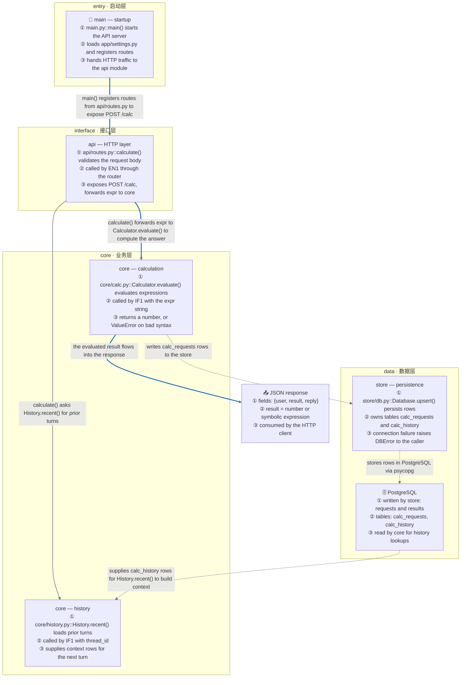

# ProjectFlow

One analysis pass, two deliverables.

1. **Module overview (default)** → `docs/project_overview.md`: a module-level Mermaid map for people meeting the project for the first time. Every module is one role-colored node inside its layer subgraph; solid edges show who imports/calls whom (labelled with the concrete symbols passed); dashed edges show which way data moves (or where fallbacks run); the main path is highlighted in blue. Under the map: a **reading guide** (numbered steps anchored to real `file::symbol()`), a **File Catalog** with one row per source file, and **Data Flow** notes.
2. **Request flow (on demand)** → `docs/project_flow.md`: the original contract — one `flowchart TD` tracing a single request from 📥 input → one subgraph per file → 📤 output, every method annotated, every edge explained, loops and fallbacks drawn.

Why this order: a newcomer first needs *"what exists and how it fits together"* (module level) and only then *"how one request travels"* (flow level). The module map answers — what does each file do, how do files reference each other, and where does data flow — without drowning in per-method detail.

## §0 Mode router (decide before reading the code)

| Mode | The request asks for… | Output |
|---|---|---|
| `overview` (default) | project structure, module map, what each file does, who calls whom, where data flows, onboarding — 模块图 / 项目结构图 / 项目地图 / 模块依赖 / 数据流向 / 新人导读 / 看懂项目 / project structure / module diagram / architecture overview / map the project | `docs/project_overview.md` |
| `flow` | the path of ONE concrete request/run through the code: an endpoint, `main()`, a CLI command, a message — 执行链路 / 请求流程 / 调用链 / trace the flow / how does this project run | `docs/project_flow.md` |

Default to `overview`. Switch to `flow` only when the request names a specific entry to trace. A bare "draw the project flow / 画项目流程图" now means `overview` — the module map is the skill's front door; name a request for the flow view.

## §1 Analysis phase (both modes — AST-first, before writing anything)

Systematically discover the codebase with AST parsing:

- **Python**: `ast` module — classes, functions, decorators, imports, call sites
- **JavaScript/TypeScript**: `ts-morph` or `babel/parser` — exports, declarations, class methods, imports
- **Other languages**: language-appropriate AST parser

**Required discovery outputs** (temp JSON, see §10):

- `entry_points`: `[{file, function/class, role}]` — `main()`, handlers, CLI commands, HTTP routes
- `file_roles`: file → `entry | iface | core | data | io | ext` (rules below; first match wins)
- `import_graph`: directed file → file edges `{from_file, to_file, symbols[], call_type}` for imports/calls **between project files**
- `external_deps`: imports from outside the project, tagged `stdlib` or `ext`
- `data_stores`: modules touching DB / cache / queue / file store / external API (see §2 M6)
- `loop_edges`: cycles in the graph (SCCs with > 1 node, or self-loops)

File-role rules, in priority order:

1. `entry` — contains the process entry (`if __name__ == "__main__"`, `main()`, `@click`, `bin` in package.json) or loads startup config
2. `iface` — HTTP routes, handlers, middleware, GraphQL resolvers, gRPC services, message consumers
3. `core` — business logic, algorithms, state machines, orchestration
4. `data` — DB/ORM/cache clients, repositories, DAOs
5. `io` — file read/write, HTTP clients, message queue producers/consumers
6. `ext` — thin wrappers around an external SDK/framework

Entry-point patterns: Python `if __name__ == "__main__"`, `main()`, `@app.route`, FastAPI, `typer`, `argparse`, `click`; JS/TS `export default`, `export function`, `app.get/post`, `createServer`, CLI `bin` in `package.json`; other languages, their conventional entry markers.

**Primary entry** (drives `EN1` and the reading guide): when several modules qualify as `entry`, the primary is the one importing the most other modules — the wiring module references the widest graph; ties break by module path, alphabetically.

**No-parser fallback** (keeps the skill usable on a bare machine): if the language has no AST tool available — no `python3` for Python, no `ts-morph` or `babel/parser` for JS/TS, no toolchain for other languages — scan import/require statements with regex, read each file's top-level symbols by eye, and disclose the method in the document's mechanism notes (`> Discovery method: import-scan fallback — no AST parser available`). The module map stays valid; only per-symbol detail may be shallower.

## §2 Module extraction (overview mode only)

A **module** is the unit a newcomer can hold in their head: one directory/package, summarized in one node.

- **M1 — build**: every directory that contains source files is a module. Each repo-root file is its own singleton module.
- **M2 — role**: a module's role = the highest-priority role among its files (`entry > iface > core > data > io > ext`).
- **M3 — cap at 12 primary modules** (past ~12 nodes a map stops being glanceable). While modules > 12: merge the alphabetically-first pair of sibling modules sharing a parent directory into a single module named after that parent directory (all files and their paths are kept); when the shared parent is the repo root, merge the pair into the alphabetically-first module of the two instead. Repeat until ≤ 12 remain. Merged files stay visible in the File Catalog — the cap shrinks the map, never the catalog.
- **M4 — single module**: skip layer subgraphs entirely; draw bare nodes.
- **M5 — reference edges**: aggregate `import_graph` file edges into module edges. Label = the up-to-3 most-imported symbols on that edge (by frequency, then alphabetical), plus why the caller needs them.
- **M6 — data nodes**: every `data_stores` target (database, cache, queue, file store, third-party service) becomes a `:::data` or `:::ext` node — *where does data live* is a newcomer's first question, so it must be on the map.
- **M7 — plain libraries are not nodes**: third-party libraries with no runtime boundary (lodash, pydantic) are listed in a one-line "not drawn" note, not as nodes.

## §3 Document skeleton — overview mode (default)

````markdown
# Project Overview (PROJECT_FLOW)

> Project: <name> — <one line: what it is, main stack, and the one main path, e.g. "FastAPI calculator: HTTP → validation → evaluation → JSON response">
> Start reading here: `<entry file>::<fn>()` — <why it is the front door>

## Module Map (Mermaid)

Legend: solid arrow `-->` = code reference (A imports/calls B); dashed arrow `-.->` = data movement (rows/requests flow in the arrow's direction) or a fallback path.

```mermaid
flowchart TD
    %% ---- color classes: copy verbatim, every one needs color: ----
    classDef entry fill:#e3f2fd,stroke:#1565c0,stroke-width:2px,color:#0b2c4d
    classDef iface fill:#e0f2f1,stroke:#00695c,stroke-width:2px,color:#04302b
    classDef core  fill:#ede7f6,stroke:#5e35b1,stroke-width:2px,color:#2a1152
    classDef data  fill:#e0f7fa,stroke:#00838f,stroke-width:2px,color:#053b42
    classDef io    fill:#e8f5e9,stroke:#2e7d32,stroke-width:2px,color:#0c3d12
    classDef ext   fill:#f5f5f5,stroke:#9e9e9e,stroke-width:2px,color:#1a1a1a
    classDef warn  fill:#fff3e0,stroke:#ef6c00,stroke-width:2px,color:#4a2500
    classDef out   fill:#fce4ec,stroke:#ad1457,stroke-width:2px,color:#4a0d24

    %% ==================== Entry:how the project starts ====================
    subgraph SUB_ENTRY["entry · 启动层"]
        direction TB
        EN1["📍 <module name> — startup<br/>① <files>::<entry()> <what it starts><br/>② <what it loads: config, wiring, routes><br/>③ <what it hands off first>"]:::entry
    end

    %% ==================== <layer name>:what this layer does ====================
    subgraph SUB_IFACE["interface · 接口层"]
        direction TB
        IF1["<module name><br/>① <files>::<key()> <the module's main job><br/>② <who calls it / what it receives><br/>③ <what it exposes or returns>"]:::iface
    end

    %% ==================== Core:business logic ====================
    subgraph SUB_CORE["core · 业务层"]
        direction TB
        CO1["<module name><br/>① <files>::<Class.key()> <the module's main job><br/>② <who calls it / what it receives><br/>③ <what it computes or decides>"]:::core
    end

    %% ==================== Data:where data lives ====================
    subgraph SUB_DATA["data · 数据层"]
        direction TB
        SO1["<storage module name><br/>① <files>::<key()> <what it persists and how><br/>② <tables / keys / queues it owns><br/>③ <failure mode: connection error → ?>"]:::data
        DA1["🗄️ <PostgreSQL / Redis / S3><br/>① <written by: which modules, what><br/>② <key tables / keys / buckets><br/>③ <read by: which modules, why>"]:::data
    end

    %% ==================== External:systems we call ====================
    subgraph SUB_EXT["external · 外部依赖"]
        direction TB
        EX1["☁️ <Stripe / OpenAI / Slack><br/>① <called by: which module><br/>② <endpoint or SDK call><br/>③ <failure mode: timeout → fallback>"]:::ext
    end

    %% ==================== Output:what the project produces ====================
    OUT1["📤 <main artifact or response><br/>① <fields><br/>② <meaning of key fields><br/>③ <who consumes it>"]:::out

    %% ==================== Edges:solid = reference, dashed = data ====================
    EN1 -- "<caller> imports <symbol>() to <why>" --> IF1
    IF1 -- "<symbol>() is passed to <next module> for <why>" --> CO1
    CO1 -. "writes <rows/keys> to <table>" .-> SO1
    SO1 -. "stores <rows/keys> in <PostgreSQL>" .-> DA1
    DA1 -. "supplies <rows/keys> for <purpose>" .-> CO2
    IF1 -. "fallback:<degraded path when X is down>" .-> EX1

    linkStyle default stroke:#6b7280,stroke-width:1.5px
    linkStyle <spine indices, e.g. 0,1,6> stroke:#1565c0,stroke-width:2.5px
    linkStyle <fallback indices> stroke:#b45309,stroke-width:2px
```

> External libraries (not drawn — no runtime boundary): <pydantic, lodash, …>

## How to read this codebase (新人导读)

1. **Start**: `<file>::<fn>()` — <what happens first>
2. **Follow the spine**: `<module>` → `<module>` — <the main path>
3. **Data**: <where data is born, transformed, stored, consumed>
4. **Edges and fallback**: <what breaks gracefully, and into what>

## File Catalog

| # | File | Role | Key symbols | What it does |
|---|---|---|---|---|
| 1 | `<src/entry.py>` | entry | `<main()>, <load_config()>` | <one line: why this file exists> |

> Excluded from this map: <tests, generated, vendored files — state which and why>

## Data Flow

> <2–4 lines: where data enters, how each module transforms it in order, where it is stored, what leaves the project>

> <Mechanism: loop / memory / fallback / thresholds — what a static map cannot show, 2–4 lines>
````

Chinese-heading variant (use when the repo's docs are Chinese): `# 项目全景图 (PROJECT_FLOW)`, `## 模块地图 (Mermaid 图)`, `## 新人导读`, `## 文件目录`, `## 数据流向`, `> 图例:`, `> 外部库(未画出):`.

## §4 Document skeleton — flow mode

````markdown
# Project Flow (PROJECT_FLOW)

> Project:<name> — <one-line architecture, e.g. "LangGraph ReAct loop">
> Note: entry point is `<entry>`; execution passes through the methods/nodes below and ends in the output.

## Overall Flow (Mermaid)

```mermaid
flowchart TD
    %% ---- color classes: copy verbatim, every one needs color: ----
    classDef entry fill:#e3f2fd,stroke:#1565c0,stroke-width:2px,color:#0b2c4d
    classDef iface fill:#e0f2f1,stroke:#00695c,stroke-width:2px,color:#04302b
    classDef core  fill:#ede7f6,stroke:#5e35b1,stroke-width:2px,color:#2a1152
    classDef io    fill:#e8f5e9,stroke:#2e7d32,stroke-width:2px,color:#0c3d12
    classDef data  fill:#e0f7fa,stroke:#00838f,stroke-width:2px,color:#053b42
    classDef ext   fill:#f5f5f5,stroke:#9e9e9e,stroke-width:2px,color:#1a1a1a
    classDef warn  fill:#fff3e0,stroke:#ef6c00,stroke-width:2px,color:#4a2500
    classDef out   fill:#fce4ec,stroke:#ad1457,stroke-width:2px,color:#4a0d24

    %% ==================== Input:<source> ====================
    IN1["📥 <input name><br/>① <protocol/entry> carries <fields><br/>② <meaning of the key fields><br/>③ <meaning of special switches>"]:::io

    %% ==================== <stage name>:<what this layer does> ====================
    subgraph SUB_XXX["<file path>(<role>)"]
        direction TB
        X1["① <file path>::<method()> <what this node does><br/>② <where the inputs come from><br/>③ <what it returns / how state changes / what happens on failure>"]:::core
    end

    %% ==================== Output:<artifact> ====================
    OUT1["📤 <output name><br/>① <response body/artifact> fields<br/>② <meaning of the key fields><br/>③ <how the caller uses it>"]:::out

    %% ==================== Edges (every one carries a concrete explanation) ====================
    IN1 -- "<who sends what to whom, and why>" --> X1
    X1  -. "<resume / dependency / bypass relationship>" .-> X2

    linkStyle default stroke:#6b7280,stroke-width:1.5px
```



## Key Notes

| Step | file::Class.method / function | Purpose |
|---|---|---|
| <stage> | `<file path>::<method>()` | <one-line purpose> |

> <Mechanism>:<loop, memory, fallback, thresholds — 2 to 4 lines>
````

Chinese-heading variant: `# 项目流程图 (PROJECT_FLOW)`, `## 整体流程 (Mermaid 图)`, `## 关键说明`.

## §5 Colors

Color encodes the **role** of a node, so a reader can spot "where does it touch the disk", "where does it call the model", "where can it fail" without reading any text. Assign a class to **every** node with `:::name`.

| Class | Use for | Fill | Stroke | Text (`color:`) |
|---|---|---|---|---|
| `entry` | startup, config, entry point, the entry module | `#e3f2fd` | `#1565c0` | `#0b2c4d` |
| `iface` | routes, handlers, request intake | `#e0f2f1` | `#00695c` | `#04302b` |
| `core` | business logic, loop nodes | `#ede7f6` | `#5e35b1` | `#2a1152` |
| `io` | input/output, files, network | `#e8f5e9` | `#2e7d32` | `#0c3d12` |
| `data` | storage, database, cache, storage modules | `#e0f7fa` | `#00838f` | `#053b42` |
| `ext` | external library / framework / third-party service | `#f5f5f5` | `#9e9e9e` | `#1a1a1a` |
| `warn` | side effects, errors, fallbacks | `#fff3e0` | `#ef6c00` | `#4a2500` |
| `out` | artifacts, responses | `#fce4ec` | `#ad1457` | `#4a0d24` |

Every text/background pair measures **≥ 11:1** (WCAG AAA needs 7:1), so the labels stay readable in any theme. **`color:` is not optional**: without it the text inherits the renderer's theme color, and a dark-mode renderer paints `#ccc` on these light fills — 1.41:1, effectively invisible.

Edge coloring uses `linkStyle`, which is applied inline and therefore safe. Keep the one default rule; add index-based rules only to highlight the spine or a fallback (indices are 0-based in declaration order, so keep them in sync when edges change):

```text
    linkStyle default stroke:#6b7280,stroke-width:1.5px
    linkStyle 0,2,4 stroke:#1565c0,stroke-width:2.5px
    linkStyle 7 stroke:#b45309,stroke-width:2px
```

Pick edge colors that read on both light and dark pages: spine `#1565c0`, data flow `#2e7d32`, fallback/error `#b45309`, default `#6b7280`.

Edge **text** is not controlled by `classDef` — it comes from theme variables. If your renderer draws it too faint, add this line directly above `flowchart TD`:

```text
%%{init: {"theme":"base","themeVariables":{"textColor":"#111111","edgeLabelBackground":"#f2f4f7"},"themeCSS":".edgeLabel rect{opacity:1 !important;fill:#f2f4f7 !important}.edgeLabel,.edgeLabel span{color:#111111 !important;background-color:#f2f4f7 !important}"}}%%
```

## §6 Deterministic ordering rules (for cross-run/model consistency)

### Overview mode

**Layer order** (fixed, top to bottom): `entry` → `iface` → `core` → `data` → `io` → `ext`; `IN1`/`IO1` (a distinct inbound source, e.g. a queue, when one exists) sits right after the entry layer; `OUT1` is last. Only layers that contain nodes get a subgraph.

**Node IDs**: layer prefix + sequence, in order of appearance in the final diagram: `EN1`, `IF1`, `IF2`, `CO1`, `SO1` (storage modules) / `DA1` (stores), `IO1`, `EX1`, `OUT1`.

**Within a layer**: BFS distance from `EN1` over the aggregated module reference edges (forward direction); unreachable modules come after reachable ones, ordered among themselves by module path alphabetically. Ties break by module path alphabetically.

**Spine** (the blue path a newcomer should trace first): BFS over **solid** reference edges from `EN1` to `OUT1`; when expanding a frontier, prefer neighbors in layer order `iface < core < data < io < ext`, then alphabetically. The first path found is the spine; its edge indices get the `#1565c0` `linkStyle` rule.

**Edge declaration order** (makes `linkStyle` indices predictable): DFS from `EN1` visiting neighbors sorted by node ID, then remaining data edges (sorted by source ID, then target), then fallback/loop edges (sorted the same way).

**Data-edge direction**: an edge points the way the **data moves** — writes go module → store (`CO1 -. "writes" .-> DA1`), reads go store → module (`DA1 -. "supplies" .-> CO1`). External-service calls go module → ext node.

**Dotted edges** carry: data movement, fallback paths (`fallback:` label prefix), and module reference cycles (`(mutual reference)` / `(loop)` prefix — each direction of the cycle drawn once). Solid edges are plain code references.

### Flow mode

**Subgraph order** = execution order of a single request:
1. `entry` — startup/config (module-level code, `main()`, config loading)
2. `iface` — request intake (routes, handlers, middleware)
3. `core` — business logic, loops, state machines
4. `data` — storage, database, cache access
5. `io` — file/network I/O (distinct from data layer)
6. `ext` — external library/framework nodes
7. `out` — response/artifact assembly

**Within a file**: order methods by first call in execution flow (topological sort of call graph restricted to that file). If ambiguous, use alphabetical by method name.

**Node IDs**: `IN1`, `OUT1`, `EN1`, `IF1`, `CO1`, `DA1`, `IO1`, `EX1`, `WN1`; sequence number = order of appearance in the final diagram.

**Edge order**: declare edges in the same order as nodes are visited in a depth-first traversal from `IN1`.

## §7 Node label canonicalization

### Overview mode

- **Module node, line ①**: `<up to 3 files, + -joined>::<dominant symbol()> <the module's one job>`
- **Line ②** (input side): `<- who calls it / what it receives`
- **Line ③** (output side): `-> what it exposes, returns, or hands off`
- **Inbound source node** (`IN1`, `📥`, optional — only when inputs arrive through a channel that is not the entry module, e.g. a queue or cron): ① source (protocol/endpoint), ② key fields, ③ which module consumes it
- **Store module** (`SO1`): ① what it persists and how, ② tables/keys/queues it owns, ③ failure mode
- **Data node** (`DA1`, `🗄️`): ① written by (which modules, what), ② key tables/keys/buckets, ③ read by (which modules, why)
- **External node** (`EX1`, `☁️`): ① called by which module, ② endpoint or SDK call, ③ failure mode → fallback
- **Entry node** (`EN1`, `📍`): ① `<entry()> <what it starts>`, ② what it loads (config, wiring, routes), ③ what it hands off first
- **Output node** (`OUT1`, `📤`): ① artifact fields, ② meaning of key fields, ③ who consumes it

### Flow mode

Line ① format (exactly):
- Module function: `file.py::func_name()`
- Class method: `file.py::ClassName.method_name()`
- Module-level stmt: `(module level) file.py::stmt_description`
- Graph/framework node: `file.py::node_type node_name (source_file) entry`
- External lib: `library_name NodeType execution (mounted in file.py)`

Both modes, lines ②③: use concrete field names, types, error types. Never "processes data".

## §8 Edge label canonicalization

### Overview mode

- **Solid** (reference): `A -- "<caller> imports/calls <symbol>() to <why>" --> B`
- **Dotted — write**: `A -. "writes <rows/keys> to <store>" .-> B`
- **Dotted — read**: `B -. "supplies <rows/keys> for <purpose>" .-> A`
- **Dotted — external call**: `A -. "calls <endpoint> to <why>" .-> EX1`
- **Dotted — fallback**: `A -. "fallback:<degraded path when X is down>" .-> B`
- **Dotted — cycle**: `A -. "(mutual reference) <what bounces between them>" .-> B`

### Flow mode

Format: `A -- "direction: who → what (condition)" --> B`
- Direction: "request", "response", "data flow", "control flow", "fallback", "loop"
- Condition: "when X", "on success", "on error: Type", "if config.Y"
- Literal strings in 「」 (CJK) or '' (ASCII). Never "".

## §9 Required-elements checklists (every output must pass)

### Overview mode

- [ ] All 8 color class definitions, verbatim from §5; `flowchart TD`
- [ ] Exactly one `EN1` (📍, `:::entry`) and one `OUT1` (📤, `:::out`)
- [ ] Every node has `:::class`; every `classDef` carries a `color:` value
- [ ] ≤ 12 module nodes; §2 merge rule applied and disclosed in the mechanism notes if triggered
- [ ] Every subgraph has a unique `SUB_<UPPER>` id, a `direction TB`, and a matching `end`; no empty layer subgraphs
- [ ] Stage banner comments (`%% ==================== ... ====================`)
- [ ] Legend line under the heading; solid/dashed semantics respected everywhere
- [ ] Spine exists and its `linkStyle` indices match the declaration order (count edges from 0)
- [ ] Every `data_stores` target is a node; plain libraries listed in the "not drawn" note
- [ ] File Catalog: one row per source file, reading order = map order then alphabetical within a module; every symbol verified against the AST symbol table
- [ ] Reading guide: every `file::symbol()` anchor exists in the code
- [ ] Data Flow + 2–4 mechanism notes
- [ ] Exclusions note (tests/generated/vendored) states what and why
- [ ] Language matches repo documentation language

### Flow mode

- [ ] All 8 color class definitions, verbatim from §5; `flowchart TD`
- [ ] Exactly one `IN1` (📥, `:::io`) and one `OUT1` (📤, `:::out`)
- [ ] Every node has `:::class`; every subgraph has unique `SUB_<UPPER>` id and `end`
- [ ] Stage banner comments (`%% ==================== ... ====================`)
- [ ] `linkStyle default` rule present
- [ ] Key Notes table with **every method from diagram** (one row each)
- [ ] 2–4 mechanism notes (`> ` lines)
- [ ] Language matches repo documentation language

## §10 Temp script protocol

If AST analysis needs a script:

- Create in `temp/project_flow_analysis_<timestamp>.py` (or `.js`, etc.)
- Script must output JSON to stdout
- Read JSON, then **delete the script** before writing final output
- Never leave temp files behind

## §11 Steps

### 1. Discover the codebase (AST-first, §1)
Inventory all source files (exclude tests, `.venv`, `node_modules`, `dist`, `build`, `__pycache__`, `target`, generated files) and build the discovery JSON: symbol table, call graph, import graph, external deps, data stores, loops.

### 2. Extract modules (overview only, §2)
Apply M1–M7. Record the merge decisions you made so the self-check can audit them.

### 3. Build the deterministic structure (§6)
- Overview: fix layer order, BFS distances, node IDs, spine, edge declaration order
- Flow: pick the primary entry point (user-facing: HTTP server, CLI), trace forward through the call graph, group nodes by file, order by first appearance

### 4. Write the diagram (§3 or §4 skeleton, §7–§8 formats)
Follow the skeleton exactly. Overview: one node per module, layer subgraphs, solid/dashed edges, spine `linkStyle`. Flow: one subgraph per file on the traced path, loop back-edges drawn dashed, fallbacks drawn dashed.

### 5. Write the explanations beneath the diagram
- Overview: reading guide (§3), File Catalog — one row per file in map order, Data Flow narrative, mechanism notes
- Flow: Key Notes table — one row per unique `file::method()` in node-appearance order, mechanism notes covering (pick 2–4): loop termination, state/memory resumption, fallback/degradation, concurrency model, config-driven switches, retry/timeout thresholds

### 6. Write the file & self-check
Write the output file (`docs/project_overview.md` or `docs/project_flow.md`; create `docs/` if needed, overwrite previous). Then run the §9 checklist for the mode — every item must pass before handoff.

## §12 Worked example (overview mode)

Project: a FastAPI calculator — `main.py` (entry), `api/routes.py` (iface), `core/calc.py` + `core/history.py` (core), `store/db.py` (data), PostgreSQL behind the store.



File Catalog for the same project:

| # | File | Role | Key symbols | What it does |
|---|---|---|---|---|
| 1 | `main.py` | entry | `main()` | starts the server, wires config and routes |
| 2 | `api/routes.py` | iface | `calculate()` | validates POST /calc, orchestrates core |
| 3 | `core/calc.py` | core | `Calculator.evaluate()` | evaluates arithmetic expressions |
| 4 | `core/history.py` | core | `History.recent()` | loads prior turns for a thread |
| 5 | `store/db.py` | data | `Database.upsert()` | PostgreSQL access layer |

> External libraries (not drawn — no runtime boundary): FastAPI, pydantic, psycopg

## §13 Syntax red lines (verified against Mermaid 11)

1. **No double quotes inside a node label.** `A["say "hi" now"]` fails; `A["say "hi""]` parses but swallows quotes; backslash-escaping (`\"`) not supported. Use 「」 or single quotes.
2. **Angle brackets vanish silently** — in node AND edge labels. `List<String>` → `List`; `<https://example.com>` disappears. Write generics as `List&lt;String&gt;` or full-width `＜ ＞`. `#lt;`/`#gt;` entities render as mojibake.
3. `\n` does not break a line — use `<br/>`.
4. `%%` comment cannot share a line with code; must sit on its own line.
5. Brackets cannot be omitted: `B[load(x)]` fails → **always quote labels**.
6. Do not use `end`, `class`, `graph`, `style`, `subgraph`, `flowchart`, `linkStyle` as node ids (all fail), and do not use file names as ids.
7. Declare a node once, inside its own subgraph — referencing it inside another subgraph silently **moves** it there.
8. Edge labels never wrap (`white-space: nowrap`); break long ones with `<br/>` yourself.

> Color classes, edge colors, and the optional fix for faint edge text live in the **§5 Colors** section above.
