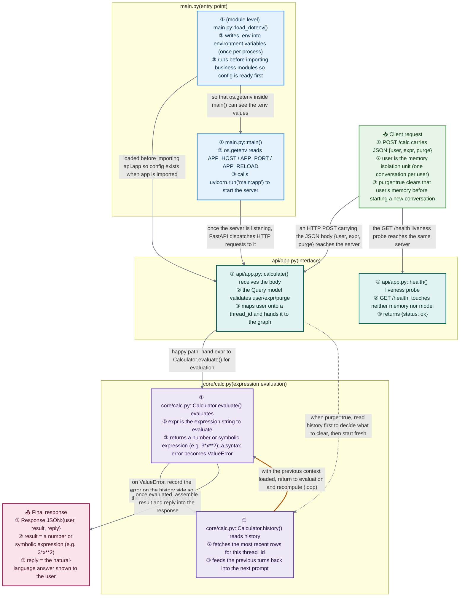

```mermaid
flowchart TD
    %% ---- color classes: copy verbatim, every one needs color: ----
    classDef entry fill:#e3f2fd,stroke:#1565c0,stroke-width:2px,color:#0b2c4d
    classDef iface fill:#e0f2f1,stroke:#00695c,stroke-width:2px,color:#04302b
    classDef core  fill:#ede7f6,stroke:#5e35b1,stroke-width:2px,color:#2a1152
    classDef io    fill:#e8f5e9,stroke:#2e7d32,stroke-width:2px,color:#0c3d12
    classDef data  fill:#e0f7fa,stroke:#00838f,stroke-width:2px,color:#053b42
    classDef ext   fill:#f5f5f5,stroke:#9e9e9e,stroke-width:2px,color:#1a1a1a
    classDef warn  fill:#fff3e0,stroke:#ef6c00,stroke-width:2px,color:#4a2500
    classDef out   fill:#fce4ec,stroke:#ad1457,stroke-width:2px,color:#4a0d24

    %% ==================== Input:<source> ====================
    IN1["📥 <input name><br/>① <protocol/entry> carries <fields><br/>② <meaning of the key fields><br/>③ <meaning of special switches>"]:::io

    %% ==================== <stage name>:<what this layer does> ====================
    subgraph SUB_XXX["<file path>(<role>)"]
        direction TB
        X1["① <file path>::<method()> <what this node does><br/>② <where the inputs come from><br/>③ <what it returns / how state changes / what happens on failure>"]:::core
    end

    %% ==================== Output:<artifact> ====================
    OUT1["📤 <output name><br/>① <response body/artifact> fields<br/>② <meaning of the key fields><br/>③ <how the caller uses it>"]:::out

    %% ==================== Edges (every one carries a concrete explanation) ====================
    IN1 -- "<who sends what to whom, and why>" --> X1
    X1  -. "<resume / dependency / bypass relationship>" .-> X2

    linkStyle default stroke:#6b7280,stroke-width:1.5px
```

Produce `docs/project_flow.md`: a single Mermaid flowchart that traces the project from entry point to output, plus a key-notes table underneath.

## Document skeleton (follow this structure)

````markdown
# Project Flow (PROJECT_FLOW)

> Project:<name> — <one-line architecture, e.g. "LangGraph ReAct loop">
> Note: entry point is `<entry>`; execution passes through the methods/nodes below and ends in the output.

## Overall Flow (Mermaid)



## Key Notes

| Step | file::Class.method / function | Purpose |
|---|---|---|
| <stage> | `<file path>::<method>()` | <one-line purpose> |

> <Mechanism>:<loop, memory, fallback, thresholds — 2 to 4 lines>
````

When the repo's documentation is in Chinese, use the Chinese headings instead (`# 项目流程图 (PROJECT_FLOW)`, `## 整体流程 (Mermaid 图)`, `## 关键说明`, `> 说明:`).

## Colors

Color encodes the **role** of a node, so a reader can spot "where does it touch the disk", "where does it call the model", "where can it fail" without reading any text. Assign a class to **every** node with `:::name`.

| Class | Use for | Fill | Stroke | Text (`color:`) |
|---|---|---|---|---|
| `entry` | startup, config, entry point | `#e3f2fd` | `#1565c0` | `#0b2c4d` |
| `iface` | routes, handlers, request intake | `#e0f2f1` | `#00695c` | `#04302b` |
| `core` | business logic, loop nodes | `#ede7f6` | `#5e35b1` | `#2a1152` |
| `io` | input/output, files, network | `#e8f5e9` | `#2e7d32` | `#0c3d12` |
| `data` | storage, database, cache | `#e0f7fa` | `#00838f` | `#053b42` |
| `ext` | external library / framework node | `#f5f5f5` | `#9e9e9e` | `#1a1a1a` |
| `warn` | side effects, errors, fallbacks | `#fff3e0` | `#ef6c00` | `#4a2500` |
| `out` | artifacts, responses | `#fce4ec` | `#ad1457` | `#4a0d24` |

Every text/background pair measures **≥ 11:1** (WCAG AAA needs 7:1), so the labels stay readable in any theme. **`color:` is not optional**: without it the text inherits the renderer's theme color, and a dark-mode renderer paints `#ccc` on these light fills — 1.41:1, effectively invisible.

Edge coloring uses `linkStyle`, which is applied inline and therefore safe. Keep the one default rule; add index-based rules only to highlight the spine or a fallback (indices are 0-based in declaration order, so keep them in sync when edges change):

```text
    linkStyle default stroke:#6b7280,stroke-width:1.5px
    linkStyle 0,2,4 stroke:#1565c0,stroke-width:2.5px
    linkStyle 7 stroke:#b45309,stroke-width:2px
```

Pick edge colors that read on both light and dark pages: spine `#1565c0`, data flow `#2e7d32`, fallback/error `#b45309`, default `#6b7280`.

Edge **text** is not controlled by `classDef` — it comes from theme variables. If your renderer draws it too faint, add this line directly above `flowchart TD`:

```text
%%{init: {"theme":"base","themeVariables":{"textColor":"#111111","edgeLabelBackground":"#f2f4f7"},"themeCSS":".edgeLabel rect{opacity:1 !important;fill:#f2f4f7 !important}.edgeLabel,.edgeLabel span{color:#111111 !important;background-color:#f2f4f7 !important}"}}%%
```

## Steps

### 1. Find the entry point and the output

Read `README`, `AGENTS.md`, startup scripts, and the `main`/`app`/`cmd` directories to establish: the **entry point** (what the outside world triggers), the **output** (what the response or artifact looks like), and the **external dependencies** (models, databases, third-party APIs). If there is no obvious entry, work backwards from the method nobody calls.

### 2. Layer by execution order, not by directory

The subgraph order is the order a request travels, **not** alphabetical directory order:

```
input → entry (startup/config) → interface (routes/handlers) → orchestration (main flow/state machine)
      → core loop (think ⇄ act) → support (model factory, tool registry, storage) → output
```

Use **one subgraph per file** — closely related small files may share one subgraph, listing them in the title with `, `. Titles carry the **project-relative path plus a role**: `subgraph SUB_APP["api/app.py(interface)"]`. Wherever a loop exists (agent ⇄ tools), the **back-edge must be drawn**.

### 3. Write the nodes

Node ids are **short mnemonics plus a number**: derive them from the role (`IN1`/`OUT1`/`M1`/`APP1`/`MEM1`/`AG1`/`RT1`/`TL1`/`RS1`/`LLM1`…). The boundaries are always `IN1` and `OUT1`.

Label structure (separated by `<br/>`; use 2 to 4 numbered lines, extending to ④⑤ when there is more to say):

```
X1["① <path>::<Class.method()> <what this node does><br/>② <where parameters/inputs come from><br/>③ <what it returns / how state changes / fallback on failure>"]
```

**How to write the location in line ①:**

| Case | Form |
|---|---|
| Module-level function | `api/app.py::calculate()` |
| Method on a class | `agent/memory.py::MilvusCheckpointer.get_tuple()` |
| Module-level statement | `(module level) main.py::load_dotenv()` |
| Graph node / framework node | `agent/graph.py::compress node (agent/summarizer.py) entry` |
| Something from an external library | `langgraph ToolNode execution (mounted in agent/graph.py)` |

**What ②③ carry:** where parameters come from, what is returned, how state changes, what condition triggers this node, how failure degrades, what side effects occur. Use concrete values, thresholds and field names — never "processes data" or "does some work".

**Boundary nodes:** start with `📥` (input) or `📤` (output), carry no method name; ① states the protocol and key fields, ② the field semantics, ③ any special switches. Give them the `io` class.

**Color class:** every node ends with `:::name` from the palette above. Pick by **role, not by file** — a calculation living in an API file is `core`, and the one node that writes to disk is `io` even if it sits in the middle of the flow.

### 4. Write the edges

Three forms — and **every edge must say what is passed, why, and under what condition**. Long labels are fine:

```text
A -- "main path: who hands what to whom" --> B
A -. "resume / dependency / bypass / compile-time choice" .-> B
A == "data flow: batch or persist" ==> B
```

- Always draw loop back-edges and say so in the label ("back to X to continue (loop)")
- Always draw fallback paths, e.g. "Milvus unavailable → in-memory fallback"
- Inside an edge label, wrap literal strings in 「」 or single quotes — never double quotes, which delimit the label itself

### 5. After the diagram

- **Stage banners**: precede each stage with `%% ==================== <stage name>:<what> ====================`. `%%` comments must sit on their own line.
- **Key Notes table**: `Step | file::Class.method / function | Purpose`. **Every method that appears in the diagram gets a row**; the purpose column says what problem it solves.
- **Mechanism notes**: 2 to 4 `>` lines covering what the diagram cannot show — how the loop terminates, how memory resumes, how history is compressed, what happens when a dependency is down.

### 6. Write the file and self-check

Write `docs/project_flow.md` (create `docs/` if needed), overwriting any previous version.

- [ ] The diagram parses: starts with `flowchart TD`, every `subgraph` has a matching `end`
- [ ] Subgraph order follows execution order; methods inside a file follow call order
- [ ] Every method in the diagram reads `path::method()` and actually exists in the code (never invent one)
- [ ] Every node's ① line has an action; ② onwards carries concrete detail; no filler
- [ ] Every edge has a concrete explanation; loop back-edges and fallback paths are present
- [ ] Every node carries a color class (`:::core`, `:::io`, …) and every `classDef` has a `color:` value
- [ ] The Key Notes table covers every method in the diagram; 2 to 4 mechanism notes follow
- [ ] Language matches the repo's documentation language

## Worked example

````markdown
# Project Flow (PROJECT_FLOW)

> Project:Calc Service — FastAPI + multi-turn memory
> Note: entry point is `main`; execution passes through the methods/nodes below and ends in the output.

## Overall Flow (Mermaid)



## Key Notes

| Step | file::Class.method / function | Purpose |
|------|-------------------------------|---------|
| Entry | `main.py::main()` | Reads env vars, starts uvicorn, loads the FastAPI app |
| Config | `main.py::load_dotenv()` | Writes .env into env vars (called exactly once) |
| Interface | `api/app.py::calculate()` | Receives user/expr/purge, maps user to thread_id |
| Probe | `api/app.py::health()` | GET /health, returns {status: ok} |
| Evaluate | `core/calc.py::Calculator.evaluate()` | Evaluates an expression, raises ValueError on failure |
| History | `core/calc.py::Calculator.history()` | Fetches recent rows for a thread_id to rebuild the prompt |
| Output | `api/app.py::Response` | Returns JSON:user / result / reply |

> Loop: evaluate → load history → recompute with context, until no expression fails, then respond.
> Memory: one thread_id per user, history isolated per user; `purge: true` clears before recording.
```
````

## Syntax red lines (verified against mermaid 11)

1. **No double quotes inside a node label.** `A["say "hi" now"]` fails to parse; `A["say "hi""]` parses but silently swallows the quotes; backslash-escaping (`\"`) is not supported either. Use 「」 or single quotes.
2. **Angle brackets vanish silently** — in node *and* edge labels. `List<String>` becomes `List`; `<https://example.com>` disappears entirely. Since line ① carries real signatures, write generics as `List&lt;String&gt;` (or full-width `＜ ＞`). The `#lt;` / `#gt;` entity syntax is broken in mermaid 11 and renders as mojibake, like `#quot;`.
3. `\n` does not break a line — use `<br/>`.
4. A `%%` comment cannot share a line with code; it must sit on its own line.
5. Brackets cannot be omitted: `B[load(x)]` fails → **always quote labels**.
6. Do not use `end`, `class`, `graph`, `style`, `subgraph`, `flowchart`, `linkStyle` as node ids (all fail), and do not use file names as ids.
7. Declare a node once, inside its own subgraph — referencing it inside another subgraph silently **moves** it there.
8. Edge labels never wrap (`white-space: nowrap`); break long ones with `<br/>` yourself.

> Color classes, edge colors, and the optional fix for faint edge text live in the **Colors** section above.
